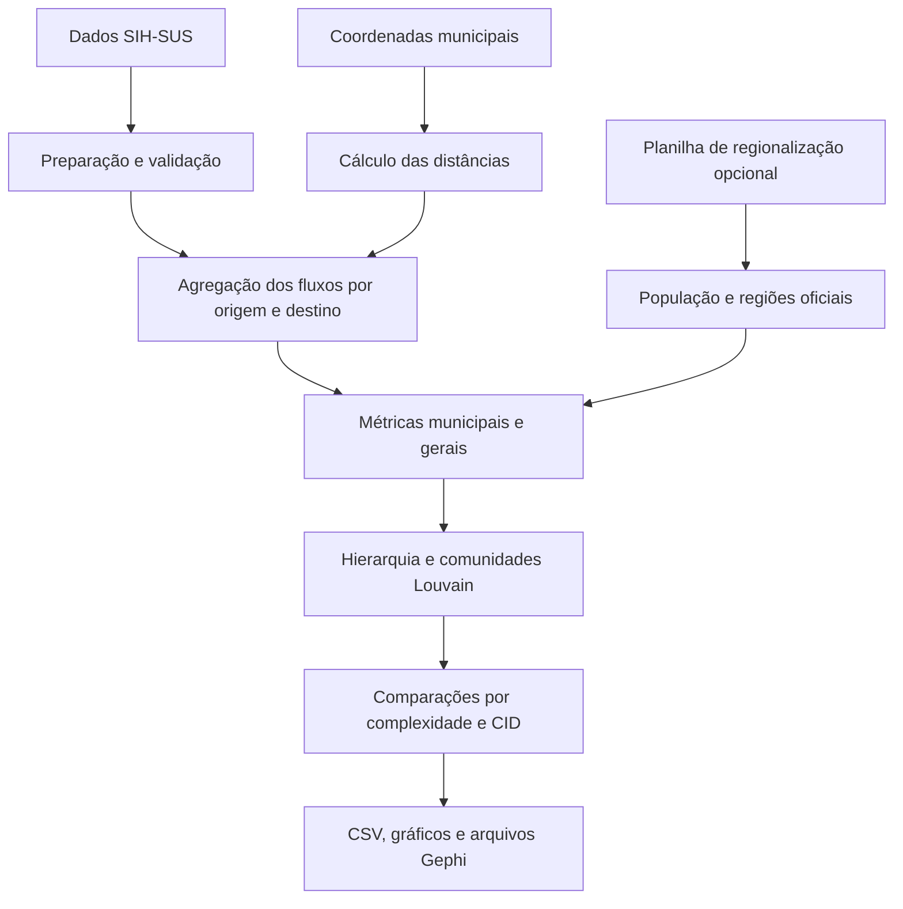

# Rede de Fluxos de Internações do SUS em Minas Gerais

Professor: Michel Pires da Silva  
Aluna: Mariana Kaori Yano 
Algoritmos e Estruturas de Dados II - UFCI-MG

## Introdução

O Sistema Único de Saúde (SUS) organiza serviços de saúde distribuídos por diferentes municípios e regiões. Quando uma pessoa precisa de internação, ela pode ser atendida no próprio município de residência ou precisar se deslocar para outro local. Observar esses deslocamentos ajuda a descrever como os serviços hospitalares são utilizados no território.

Este projeto analisa internações do SIH-SUS em Minas Gerais e modela os deslocamentos como uma rede de municípios. Cada município é representado por um nó; cada fluxo entre o município de residência e o município da internação é uma aresta direcionada, ponderada pelo número de internações registradas.

O objetivo é caracterizar os fluxos intermunicipais, identificar municípios que recebem internações de residentes de outras localidades, detectar comunidades de fluxo e comparar os deslocamentos entre níveis de complexidade e recortes diagnósticos. O projeto também calcula distâncias geográficas entre municípios para destacar aqueles cujos residentes percorrem distâncias relativamente maiores.

## Metodologia

Os dados do SIH-SUS são preparados para manter AIHs normais, residentes da UF selecionada e códigos municipais válidos. As internações são agregadas por município de residência e município da internação. O peso de cada aresta corresponde ao número de internações daquele par de municípios.

As coordenadas de latitude e longitude são usadas para calcular a distância em linha reta pela fórmula de Haversine. Essa distância é calculada pelo programa: não vem no banco do SUS e não representa distância rodoviária nem tempo de viagem.

O programa calcula volumes de entradas e saídas intermunicipais, proporções de internações feitas fora do município, médias e medianas de distância e proporções acima de 60 km e 100 km. No resumo municipal, a distância média por internação dos residentes conta internações locais como zero. Também é calculada a distância média considerando somente as internações realizadas fora do município.

Para destacar os municípios com maiores deslocamentos, o código classifica como **Maiores distâncias** os municípios cuja distância média por internação está no percentil 75 ou acima no recorte analisado. O ponto de corte em quilômetros é calculado uma vez para cada recorte e registrado nos resultados. A classe é relativa aos municípios comparados; não demonstra, por si só, carência ou ausência de serviço.

As comunidades são detectadas com Louvain em uma projeção não direcionada: os fluxos nos dois sentidos entre municípios são somados como peso da ligação, e fluxos locais são excluídos do algoritmo. A rede original permanece direcionada para calcular entradas e saídas. A distância não é usada como peso do Louvain. Dentro de cada comunidade, o polo é definido como o município com maior força de entrada intermunicipal.

### Estrutura do projeto

```text
.
├── fluxos_saude.py              # ponto de entrada e execução pelo terminal
├── conferir_dados.py            # conferências auxiliares dos dados
├── requirements.txt             # dependências Python
├── Planilha-de-Regionalizacao_Versao-2026.xlsx
├── GUIA_DO_CODIGO.md             # guia detalhado da implementação
└── rede_saude/
    ├── cli.py                   # argumentos e comandos
    ├── config.py                # configurações e nomes de colunas
    ├── dados.py                 # leitura e preparação dos dados
    ├── grafo.py                 # fluxos, métricas, hierarquia e comunidades
    ├── pipeline.py              # coordenação das análises
    └── relatorios.py            # tabelas, gráficos e exportações
```

### Bibliotecas utilizadas

| Biblioteca | Função no projeto |
|---|---|
| `pandas` | Leitura, preparação, agrupamento e exportação de tabelas |
| `numpy` | Operações numéricas e vetorizadas |
| `networkx` | Construção do grafo e detecção de comunidades Louvain |
| `openpyxl` | Leitura da planilha de regionalização em Excel |
| `matplotlib` | Geração de gráficos PNG |
| `datasus-dbc` | Descompressão dos arquivos DBC do DATASUS no comando de download |
| `dbfread` | Leitura dos arquivos DBF após a descompressão |

### Principais funções

| Função | Funcionalidade |
|---|---|
| `preparar` | Filtra AIHs normais, residentes do estado e códigos municipais válidos |
| `haversine` | Calcula a distância em linha reta entre coordenadas municipais |
| `montar_pares` | Agrupa internações em fluxos de município de residência para município de internação |
| `metricas` | Calcula indicadores de deslocamento para a base geral e grupos analisados |
| `tabela_municipios` | Gera métricas municipais, incluindo distâncias médias e classe “Maiores distâncias” |
| `detectar_comunidades_louvain` | Detecta comunidades e resume seus polos e composição regional |
| `hierarquia` | Constrói uma hierarquia complementar a partir dos fluxos dominantes |
| `interpretar_nicho` | Interpreta recortes CID e filtros por complexidade informados no terminal |
| `exportar_tabelas_gephi` | Exporta nós e arestas para visualização no Gephi |
| `analisar` | Coordena a execução da análise geral e dos nichos solicitados |

### Parâmetros principais

- `--uf` e `--ano`: estado e ano da análise (padrões: `MG` e `2025`).
- `--dados` e `--saida`: pastas de entrada e saída.
- `--planilha`: planilha opcional com população e regionalização oficial. Ela é necessária para calcular taxas por mil habitantes e comparar comunidades com microrregiões e macrorregiões.
- `--nicho`: recorte diagnóstico e, opcionalmente, nível de complexidade; pode ser repetido.
- `--min-fluxo`: fluxo mínimo aplicado à hierarquia complementar (padrão: 2). Não remove registros dos CSVs nem altera as métricas de distância.
- `--louvain-resolucao` e `--louvain-semente`: parâmetros do Louvain (padrões: `1.0` e `42`).
- `--excluir-proc`: prefixo de procedimento excluído da comparação de complexidade como análise de robustez.
- `--sem-nomes`: não consulta a API pública do CNES para obter nomes de hospitais.

### Fluxograma da execução



## Resultados

A pasta `saida_neoplasias/` contém uma execução salva para Minas Gerais em 2025. A tabela abaixo resume alguns indicadores de `comparacao.csv`:

| Recorte | Internações | Feitas fora do município | Distância média de quem se deslocou | Distância mediana de quem se deslocou |
|---|---:|---:|---:|---:|
| Geral | 1.582.189 | 36,6% | 61,3 km | 37,0 km |
| Alta complexidade | 146.652 | 58,2% | 84,3 km | 56,2 km |
| Média complexidade | 1.435.537 | 34,4% | 57,3 km | 34,6 km |
| Neoplasias | 131.916 | 53,8% | 72,2 km | 49,5 km |
| Neoplasias - alta complexidade | 53.621 | 61,3% | 75,4 km | 53,1 km |
| Neoplasias - média complexidade | 78.295 | 48,7% | 69,4 km | 45,4 km |

Na execução registrada, a alta complexidade apresenta proporção maior de internações fora do município e distâncias médias e medianas maiores do que a média complexidade. Os resultados são descritivos e não demonstram, isoladamente, a causa desses deslocamentos.

### Análise de custo computacional

Considere `N` como o número de registros de internação, `V` como o número de municípios e `E` como o número de pares origem-destino distintos. A leitura e a preparação percorrem a base de internações; a agregação produz o grafo com `V` nós e `E` arestas. O consumo de memória depende principalmente da base carregada e das estruturas do grafo, portanto cresce com o volume de registros e fluxos. A detecção Louvain realiza passagens iterativas pelo grafo; seu tempo depende da estrutura da rede e da quantidade de passagens até estabilizar. O programa também informa o tempo total da execução.

## Conclusão

O projeto transforma registros de internação em uma rede direcionada de fluxos entre municípios e oferece métricas para descrever deslocamentos, municípios receptores e comunidades assistenciais. As comparações por complexidade e CID permitem examinar se os padrões variam entre recortes. A distância em linha reta e os registros de internação têm limitações: não equivalem a trajetos rodoviários ou pessoas únicas, e não medem diretamente capacidade instalada nem necessidade de atendimento não atendida.

## Como instalar e executar

### Requisitos

- Ubuntu 24.04.
- Python 3, `venv` e acesso à internet para baixar os dados, quando necessário.

### Instalação

```bash
git clone https://github.com/marisxzh/rede-saude.git
cd rede-saude
sudo apt update
sudo apt install -y python3 python3-venv python3-pip
python3 -m venv .venv
source .venv/bin/activate
python -m pip install --upgrade pip
python -m pip install -r requirements.txt
```

### Obter a base do SIH-SUS

O comando `baixar` obtém os arquivos mensais DBC do DATASUS e prepara a base usada pela análise:

```bash
python fluxos_saude.py baixar --uf MG --ano 2025 --dados dados
```

O arquivo resultante é `dados/rd_MG_2025.csv.gz`. Se a base for obtida pelo repositório científico do projeto, coloque o arquivo nesse caminho e pule o comando `baixar`. As coordenadas municipais são carregadas de `dados/municipios_coord.csv` e podem ser baixadas automaticamente quando necessário.

### Executar a análise geral e os recortes de neoplasias

```bash
python fluxos_saude.py analisar \
  --uf MG \
  --ano 2025 \
  --dados dados \
  --saida saida_neoplasias \
  --planilha Planilha-de-Regionalizacao_Versao-2026.xlsx \
  --sem-nomes \
  --nicho "Neoplasias=C,D00-D48" \
  --nicho "Neoplasias_Alta=C,D00-D48@03" \
  --nicho "Neoplasias_Media=C,D00-D48@02"
```

O programa sempre analisa a base geral; cada argumento `--nicho` adiciona um recorte. `C,D00-D48` representa os códigos CID de neoplasias utilizados pelo projeto, `@03` seleciona alta complexidade e `@02` seleciona média complexidade. Para executar somente a análise geral, retire os argumentos `--nicho`.

## Arquivos de saída

Os resultados são gravados na pasta informada por `--saida`:

- `comparacao.csv` e `comparacao.png`: comparação de métricas gerais, por complexidade e por nicho.
- `fluxos_geral.csv` e `municipios_geral.csv`: fluxos e resumo municipal da base geral.
- `fluxos_nicho_<nome>.csv` e `municipios_nicho_<nome>.csv`: fluxos e resumos municipais de cada nicho.
- `municipios_comunidades_geral.csv` e `comunidades_geral.csv`: comunidades municipais e resumo dos grupos.
- `por_tipo_de_doenca.csv` e `por_hospital.csv`: resumos por diagnóstico e hospital.
- `gephi/`: arquivos de nós e arestas para visualização no Gephi.


## Dados do trabalho e referências

- **Código-fonte:** [github.com/marisxzh/rede-saude](https://github.com/marisxzh/rede-saude).
- **Dataset tratado:** [falta].
- **Dados de internação:** SIH-SUS / DATASUS.
- **Planilha de regionalização:** Secretaria de Estado de Saúde de Minas Gerais, arquivo `Planilha-de-Regionalizacao_Versao-2026.xlsx`.
