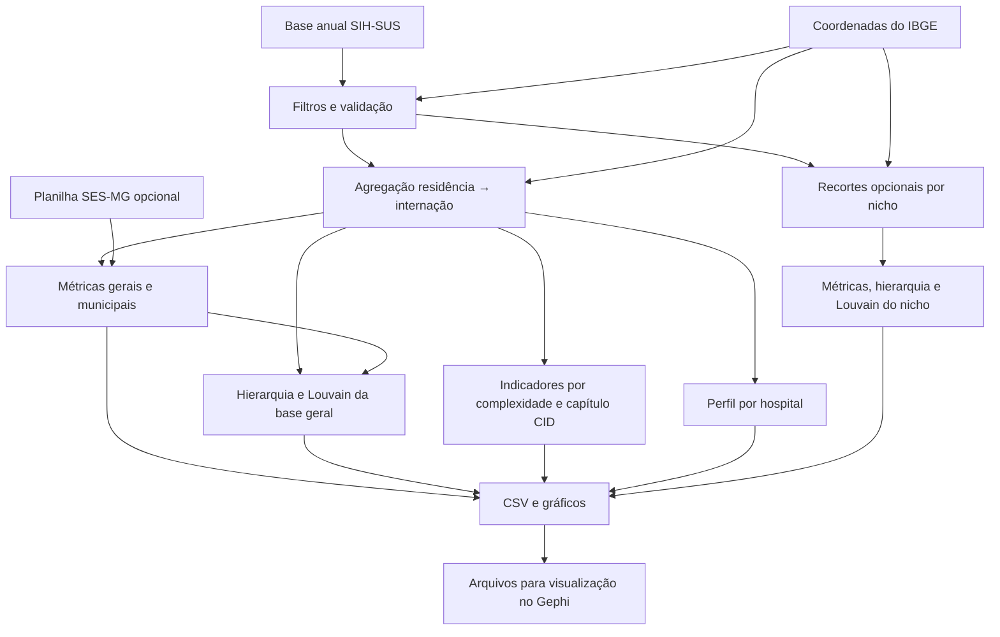

# Rede de Fluxos de Internações do SUS em Minas Gerais

Professor: Michel Pires da Silva  
Aluna: Mariana Kaori Yano 
Algoritmos e Estruturas de Dados II - UFCI-MG

## Introdução

O Sistema Único de Saúde (SUS) organiza serviços de saúde distribuídos por diferentes municípios e regiões. Quando uma pessoa precisa de internação, ela pode ser atendida no próprio município de residência ou precisar se deslocar para outro local. Observar esses deslocamentos ajuda a descrever como os serviços hospitalares são utilizados no território.

Este projeto analisa internações do SIH-SUS em Minas Gerais e modela os deslocamentos como uma rede de municípios. Cada município é representado por um nó, cada fluxo entre o município de residência e o município da internação é uma aresta direcionada, ponderada pelo número de internações registradas.

O objetivo é caracterizar os fluxos intermunicipais, identificar municípios que recebem internações de residentes de outras localidades, detectar comunidades de fluxo e comparar os deslocamentos entre níveis de complexidade e recortes diagnósticos. O projeto também calcula distâncias geográficas entre municípios para destacar aqueles cujos residentes percorrem distâncias relativamente maiores.

## Metodologia

Os arquivos mensais RD do SIH/SUS são reunidos em uma base anual. Na preparação, o programa mantém AIHs normais (`IDENT = 1`), residentes da UF selecionada e registros cujos municípios de residência e internação estejam na tabela oficial de coordenadas. Códigos municipais não encontrados nessa tabela são excluídos. `VAL_TOT` é convertido em valor numérico e valores ausentes ou inválidos são tratados como zero. Diagnósticos sem capítulo correspondente, ausentes ou não reconhecidos pela regra são classificados como “Não informado”.

O comando `baixar` obtém os arquivos mensais DBC do DATASUS e os converte para a base anual `rd_<UF>_<ANO>.csv.gz`. Ele não baixa dados do IBGE. O arquivo `dados/municipios_coord.csv` acompanha o projeto e é necessário para calcular distâncias, a planilha SES-MG é usada para população, microrregião e macrorregião. Sem a planilha, a análise geral ainda pode ser executada, mas não produz os indicadores e comparações que dependem desses atributos.

O download do SIH/SUS vem do [FTP público do DATASUS](ftp://ftp.datasus.gov.br/dissemin/publicos/SIHSUS/200801_/Dados). As coordenadas vêm do [produto Localidades do Brasil do IBGE](https://www.ibge.gov.br/geociencias/organizacao-do-territorio/estrutura-territorial/27385-localidades.html), e os nomes dos estabelecimentos podem ser consultados na [API de Dados Abertos do CNES](https://apidadosabertos.saude.gov.br/). A planilha de regionalização da SES-MG está incluída no projeto.

Os campos selecionados da base RD e seu uso são:

| Campo | Uso na análise |
|---|---|
| `IDENT` | Seleção de AIHs normais (`1`) |
| `MUNIC_RES` | Município de residência e origem do fluxo |
| `MUNIC_MOV` | Município onde ocorreu a internação e destino do fluxo |
| `DIAG_PRINC` | Recortes por capítulo CID-10 e nichos diagnósticos |
| `PROC_REA` | Conferência de procedimentos no SIGTAP e teste opcional por prefixo |
| `COMPLEX` | Separação por nível de complexidade |
| `VAL_TOT` | Porte municipal usado na hierarquia de fluxo dominante |
| `CNES` | Agrupamento e identificação dos hospitais |

Depois da preparação, as internações são agregadas por município de residência e município da internação. Cada par forma uma aresta direcionada, e seu peso é o número de internações. As internações realizadas no próprio município são representadas por laços, como A → A. Elas entram no total de internações e permanecem nos arquivos exportados. As medidas de entrada e saída e a detecção de comunidades consideram apenas os fluxos entre municípios diferentes.

As coordenadas de latitude e longitude vêm das sedes municipais do conjunto **Localidades do Brasil, Censo 2022, do IBGE**. A tabela usada pelo programa está em `dados/municipios_coord.csv`, ela pode ser recriada dos KMLs oficiais com `python scripts/gerar_coordenadas_ibge.py CAMINHO/Localidades_Municipios_kml/kml`. O código seleciona a pasta “Sede Municipal” e usa o código IBGE de sete dígitos, reduzido aos seis dígitos usados nos dados do SIH/SUS. A distância em linha reta é calculada pelo programa pela fórmula de Haversine. Vale ressaltar que não vem no banco do SUS e não representa distância rodoviária nem tempo de viagem, representa somente a distância em linha reta de um centro para outro. Fonte: [IBGE, Localidades do Brasil](https://www.ibge.gov.br/geociencias/organizacao-do-territorio/estrutura-territorial/27385-localidades.html).

O programa calcula volumes de entradas e saídas intermunicipais, proporções de internações feitas fora do município, médias e medianas de distância e proporções acima de 60 km e 100 km. No resumo municipal, a distância média por internação dos residentes conta internações locais como zero. Também é calculada a distância média considerando somente as internações realizadas fora do município.

A média e a mediana das distâncias consideram apenas as internações feitas fora do município de residência. Os fluxos com mais internações têm maior peso nesses cálculos. Já os percentuais de internações a mais de 60 km e de 100 km são calculados sobre todas as internações, incluindo as feitas no próprio município. No resumo de cada município, `dist_media_km` considera todas as internações de seus moradores e atribui distância zero às internações locais. A medida `dist_media_quem_sai_km` considera apenas as internações feitas fora do município.

Para destacar os municípios com maiores deslocamentos, o código classifica como **Maiores distâncias** os municípios cuja distância média por internação está no percentil 75 ou acima no recorte analisado. O ponto de corte em quilômetros é calculado uma vez para cada recorte e registrado nos resultados. A classe é relativa aos municípios comparados, ou seja, não demonstra, por si só, carência ou ausência de serviço.

O percentil é calculado com `pandas.Series.quantile(0.75)` (interpolação padrão `linear`) sobre as distâncias médias municipais arredondadas a uma casa decimal, considerando municípios com internações no recorte. O corte é aplicado com a regra “igual ou acima”, por isso, empates no corte podem fazer com que mais de 25% dos municípios sejam classificados como “Maiores distâncias”. Municípios sem internações no recorte ficam sem classificação.

As comunidades são detectadas com Louvain em uma projeção não direcionada: os fluxos nos dois sentidos entre municípios são somados como peso da ligação, e fluxos locais são excluídos do algoritmo. A rede original permanece direcionada para calcular entradas e saídas. A distância não é usada como peso do Louvain. Dentro de cada comunidade, o polo é definido como o município com maior força de entrada intermunicipal.

Somente municípios com pelo menos um fluxo intermunicipal entram na projeção do Louvain. A execução usa o peso de internações, resolução `1.0` e semente `42` por padrão, os demais parâmetros ficam nos valores padrão do NetworkX. A modularidade é calculada para a partição obtida. Para facilitar a apresentação, as comunidades são numeradas pela ordem crescente do menor código municipal de cada grupo, municípios sem fluxo intermunicipal recebem o código `0` e são resumidos separadamente. Em caso de empate na escolha do polo, vence o menor código municipal. O resumo também apresenta população, macrorregião e microrregião dominantes, entradas e saídas, fluxos internos e externos. Cada fluxo externo é contabilizado no resumo de cada comunidade envolvida.

A hierarquia de fluxo dominante é complementar ao Louvain. Para cada município, seleciona-se o fluxo intermunicipal de saída com maior peso entre os que atendem ao mínimo `--min-fluxo` (padrão: 2), empates são resolvidos pelo menor código de destino. O destino só é considerado superior se seu porte, calculado pela soma de `VAL_TOT` das internações realizadas no município, for maior que o porte da origem. Municípios sem superior ficam no nível 1. Esse mínimo só afeta a hierarquia, os fluxos menores permanecem na rede e no Louvain.

As métricas por complexidade e capítulo CID-10 são agregadas e comparadas, mas não recebem comunidades e hierarquias próprias. Para cada nicho informado por `--nicho`, o programa calcula uma rede própria, métricas, Louvain, hierarquia e saídas. O resumo hospitalar da execução geral agrupa internações por CNES, calcula o volume, a proporção de residentes de fora, municípios de origem, distância média dos registros de fora, participação da alta complexidade e capítulo CID-10 mais frequente. Nomes podem vir de arquivo fornecido, cache local ou API pública do CNES, `--sem-nomes` desativa a consulta à API.

### Estrutura do projeto

```text
.
├── fluxos_saude.py              # ponto de entrada e execução pelo terminal
├── conferir_dados.py            # conferências auxiliares dos dados
├── requirements.txt             # dependências Python
├── Planilha-de-Regionalizacao_Versao-2026.xlsx
├── dados/
│   ├── rd_MG_2025.csv.gz         # base anual de entrada do SIH/SUS
│   ├── municipios_coord.csv      # coordenadas IBGE das sedes municipais
│   ├── cnes_nomes_MG.csv         # cache opcional de nomes CNES
│   └── tabnet_2025.csv           # arquivo usado na conferência dos totais
├── scripts/
│   └── gerar_coordenadas_ibge.py # recria a tabela de coordenadas a partir dos KMLs
└── rede_saude/
    ├── cli.py                   # argumentos e comandos
    ├── config.py                # configurações e nomes de colunas
    ├── dados.py                 # leitura e preparação dos dados
    ├── grafo.py                 # fluxos, métricas, hierarquia e comunidades
    ├── pipeline.py              # coordenação das análises
    └── relatorios.py            # tabelas, gráficos e exportações
```

### Bibliotecas utilizadas

| Biblioteca | Função no projeto |
|---|---|
| `pandas` | Leitura, preparação, agrupamento e exportação de tabelas |
| `numpy` | Operações numéricas e vetorizadas |
| `networkx` | Construção do grafo e detecção de comunidades Louvain |
| `openpyxl` | Leitura da planilha de regionalização em Excel |
| `matplotlib` | Geração de gráficos PNG |
| `datasus-dbc` | Descompressão dos arquivos DBC do DATASUS no comando de download |
| `dbfread` | Leitura dos arquivos DBF após a descompressão |

### Funções do programa

As funções estão agrupadas por responsabilidade. As funções centrais, que definem os dados e os resultados analíticos, estão descritas com mais detalhe, as auxiliares aparecem resumidas.

#### Funções centrais

| Módulo e função | O que faz e como faz |
|---|---|
| `dados.baixar` | Percorre os 12 meses do ano e busca no FTP do DATASUS os arquivos mensais RD em formato DBC. Descomprime cada arquivo, lê os campos disponíveis, reúne os registros e grava `rd_<UF>_<ANO>.csv.gz`. Reaproveita os arquivos DBC que já existem na pasta `dados/dbc`. Não baixa coordenadas do IBGE nem a planilha SES-MG. |
| `dados.preparar` | Padroniza como texto os campos usados nos filtros, seleciona `IDENT = 1`, residentes na UF informada e registros cujos municípios de residência e internação existam na tabela de coordenadas. Converte `VAL_TOT` para número e preenche valores ausentes ou inválidos com zero. Informa quantos registros foram lidos e quantos permaneceram. |
| `dados.capitulo_do_cid` e `dados.rotular_capitulos` | A primeira função classifica um diagnóstico principal pelo capítulo CID-10. Códigos iniciados por C e D00–D48 vão para o capítulo II, os demais códigos iniciados por D vão para o capítulo III. H00–H59 vai para o capítulo VII e H60 em diante, para o capítulo VIII. A segunda aplica a classificação aos códigos distintos e devolve o rótulo de cada registro. Códigos sem capítulo correspondente na regra, como U, e valores ausentes ficam como “Não informado”. |
| `grafo.haversine` | Calcula em quilômetros a distância em linha reta entre duas coordenadas, usando a fórmula de Haversine e raio terrestre de 6.371 km. |
| `grafo.montar_pares` | Agrupa os registros por `MUNIC_RES` e `MUNIC_MOV`. Cada combinação distinta vira uma linha com origem, destino, número de internações e distância entre as sedes municipais. Combinações com origem e destino iguais são mantidas como laços locais. |
| `grafo.metricas` | A partir dos pares agregados, calcula o total de internações, a proporção realizada fora do município, média e mediana ponderadas das distâncias intermunicipais e proporções acima de 60 km e 100 km. As distâncias são ponderadas pelo número de internações do par, para os percentuais de distância, o denominador inclui também as internações locais. |
| `relatorios.tabela_municipios` | Produz uma linha por município da base municipal fornecida, incluindo internações, saídas, entradas, proporções, distância média por internação dos residentes (com fluxos locais iguais a zero) e distância média entre quem saiu. Quando a planilha é fornecida, acrescenta população, microrregião e macrorregião, além das taxas por mil habitantes. Calcula o percentil 75 sobre as médias municipais arredondadas a uma casa decimal, apenas para municípios com internações, classifica como “Maiores distâncias” os valores iguais ou acima do corte. |
| `grafo.detectar_comunidades_louvain` | Usa os pares para montar a projeção não direcionada: soma os pesos dos dois sentidos de cada ligação e remove laços locais. Inclui na detecção apenas municípios com pelo menos um fluxo intermunicipal. Executa `networkx.community.louvain_communities` com peso `n`, resolução e semente configuráveis, e calcula a modularidade. Ordena grupos pelo menor código municipal, escolhe como polo o município de maior força de entrada, desempata pelo menor código e resume os fluxos internos/externos e a composição regional. Municípios sem fluxo intermunicipal recebem comunidade 0. |
| `grafo.hierarquia` | Para cada origem, escolhe o destino de maior fluxo entre as arestas intermunicipais com peso igual ou acima de `--min-fluxo`, empates usam o menor código do destino. O destino só vira superior se o porte dele, medido pela soma de `VAL_TOT` das internações realizadas no município, for maior. Segue os superiores para determinar raiz e nível. O limiar afeta somente esta hierarquia. |
| `grafo.interpretar_nicho` | Lê cada argumento `--nicho` no formato `Nome=CID[,CID]@COMPLEXIDADE`, valida prefixos e intervalos CID e, se informado, o nível de complexidade. Também prepara um nome curto para os arquivos de saída. |
| `pipeline.analisar` | Coordena a análise: carrega coordenadas e base anual, prepara registros, calcula distâncias e rótulos CID/complexidade, gera a rede e os resultados gerais, compara complexidades e capítulos, resume hospitais e repete rede, métricas, Louvain, hierarquia e exportações para cada nicho não vazio. |
| `relatorios.exportar_tabelas_gephi` | Cria arquivos CSV de nós e arestas para a rede completa e duas versões com rótulos seletivos (20 maiores entradas e um polo por comunidade). As versões seletivas conservam todos os nós e arestas, apenas limpam os rótulos dos demais nós. |

#### Funções auxiliares

| Módulo | Funções e responsabilidade |
|---|---|
| `dados.py` | `baixar_do_ftp` tenta localizar um arquivo mensal nas pastas disponíveis do FTP, `carregar_coordenadas` lê o CSV do IBGE e adapta os nomes das colunas, `ler_planilha` extrai código, população e regiões da planilha SES-MG, `ler_nomes_arquivo` e `escolher_coluna_nome` leem arquivos locais de nomes CNES, `_consultar_cnes` consulta a API pública, `carregar_nomes_cnes` combina arquivo fornecido, cache local e API. |
| `grafo.py` | `mediana_ponderada` ordena as distâncias e encontra a posição mediana usando os pesos de internação. |
| `relatorios.py` | `salvar` traduz nomes de colunas e grava CSV, `tabela_diagnosticos` calcula indicadores por capítulo CID-10, `tabela_hospitais` resume internações por CNES, `grafico` cria gráficos PNG quando Matplotlib está instalado. |
| `pipeline.py` | `analisar` contém também os passos de agregação e gravação dos arquivos do fluxo de execução, além de chamar as funções analíticas descritas acima. |
| `cli.py` | `criar_parser` define os comandos e opções, `formatar_tempo` apresenta o tempo decorrido, `main` encaminha `baixar` ou `analisar` aos módulos correspondentes. |
| `scripts/gerar_coordenadas_ibge.py` | `_valor` lê metadados dos KMLs, `_linhas_kml` extrai sedes municipais, `gerar` valida códigos e grava o CSV, `main` interpreta os argumentos do terminal. |
| `conferir_dados.py` | `ler_tabnet` lê a tabela de comparação, `conferir_total` compara os totais do SIH com a extração TABNET, `conferir_complex` lista procedimentos para conferência no SIGTAP, o bloco principal interpreta os argumentos do script. |
| `fluxos_saude.py` e `config.py` | O arquivo de entrada chama `cli.main`, `config.py` mantém os códigos de UF, nomes das colunas, rótulos CID/complexidade, endereço do FTP e da API CNES. |

### Parâmetros principais

- `--uf` e `--ano`: estado e ano da análise (padrões: `MG` e `2025`).
- `--dados` e `--saida`: pastas de entrada e saída.
- `--planilha`: planilha opcional com população e regionalização oficial. Ela é necessária para calcular taxas por mil habitantes e comparar comunidades com microrregiões e macrorregiões.
- `--nicho`: recorte diagnóstico e, opcionalmente, nível de complexidade, pode ser repetido.
- `--min-fluxo`: fluxo mínimo aplicado à hierarquia complementar (padrão: 2). Não remove registros dos CSVs nem altera as métricas de distância.
- `--louvain-resolucao` e `--louvain-semente`: parâmetros do Louvain (padrões: `1.0` e `42`).
- `--excluir-proc`: prefixo de procedimento excluído da comparação de complexidade como análise de robustez.
- `--sem-nomes`: não consulta a API pública do CNES para obter nomes de hospitais.

No comando `baixar`, `--uf` indica o estado, `--ano` indica o ano e `--dados` indica a pasta onde os arquivos serão salvos. Para analisar os dados, o arquivo `municipios_coord.csv` precisa estar nessa pasta. A planilha de regionalização é opcional: sem ela, o programa não calcula taxas por população nem compara os municípios por microrregião e macrorregião. O programa tenta baixar os arquivos dos 12 meses. Se algum mês não estiver disponível, ele avisa e continua, por isso, confira se todos foram baixados antes de analisar o ano completo.

### Fluxograma da execução



## Resultados

Os resultados a seguir foram lidos dos arquivos da execução salva em `saida_neoplasias/`. A análise inclui a base geral, os recortes por complexidade, os capítulos CID-10 e três recortes de neoplasias. Os valores de distância são em linha reta entre sedes municipais. As médias e medianas do recorte consideram somente internações intermunicipais, os percentuais de distância usam todas as internações como denominador.

### Comparação dos recortes

| Recorte | Internações | Parte da base geral | Fora do município | Média de quem saiu | Mediana de quem saiu | Mais de 60 km | Mais de 100 km |
|---|---:|---:|---:|---:|---:|---:|---:|
| Geral | 1.582.189 | 100,0% | 36,6% | 61,4 km | 37,1 km | 11,0% | 5,9% |
| Alta complexidade | 146.652 | 9,3% | 58,2% | 84,4 km | 55,5 km | 27,0% | 15,7% |
| Média complexidade | 1.435.537 | 90,7% | 34,4% | 57,4 km | 34,7 km | 9,3% | 4,9% |
| Neoplasias | 131.916 | 8,3% | 53,8% | 72,3 km | 49,3 km | 21,2% | 11,2% |
| Neoplasias — alta complexidade | 53.621 | 3,4% | 61,3% | 75,5 km | 53,3 km | 26,1% | 13,8% |
| Neoplasias — média complexidade | 78.295 | 4,9% | 48,7% | 69,6 km | 45,2 km | 17,9% | 9,4% |

As neoplasias correspondem a 8,3% das internações analisadas. Nesse recorte, 53,8% das internações ocorreram fora do município de residência, na base geral, foram 36,6%. A média de distância entre quem saiu foi 72,3 km para neoplasias e 61,4 km para a base geral. A proporção acima de 100 km também foi maior para neoplasias: 11,2%, contra 5,9% no conjunto geral.

Dentro das neoplasias, a alta complexidade teve maior proporção de internações fora do município que a média complexidade (61,3% contra 48,7%). Também apresentou média e mediana de distância maiores e percentuais mais altos acima de 60 km e 100 km. A diferença entre os dois níveis foi de 12,6% nas internações fora do município.

### Resultados por capítulo CID-10

A tabela resume os 21 grupos do arquivo `por_tipo_de_doenca.csv`, ordenados pelo número de internações. “Distância média” e “mediana” referem-se às internações fora do município; os percentuais acima de 60 km e 100 km usam todas as internações do grupo.

| Capítulo ou grupo | Internações | Fora do município | Média (km) | Mediana (km) | >60 km | >100 km |
|---|---:|---:|---:|---:|---:|---:|
| XV — Gravidez, parto e puerpério | 183.613 | 36,0% | 43,9 | 29,1 | 6,7% | 2,9% |
| XIX — Lesões, envenenamentos e causas externas | 179.264 | 40,8% | 57,8 | 35,5 | 11,2% | 5,9% |
| IX — Aparelho circulatório | 175.757 | 41,3% | 65,7 | 42,8 | 14,2% | 7,5% |
| X — Aparelho respiratório | 167.657 | 27,1% | 49,8 | 29,5 | 5,9% | 3,0% |
| XI — Aparelho digestivo | 162.114 | 34,0% | 58,5 | 38,6 | 9,7% | 4,9% |
| II — Neoplasias | 131.916 | 53,8% | 72,3 | 49,3 | 21,2% | 11,2% |
| XIV — Aparelho geniturinário | 129.344 | 30,4% | 54,5 | 34,9 | 8,2% | 4,0% |
| I — Doenças infecciosas e parasitárias | 89.449 | 25,8% | 53,6 | 29,4 | 6,0% | 3,3% |
| XXI — Fatores que influenciam o estado de saúde | 56.810 | 37,7% | 73,1 | 42,4 | 13,8% | 8,1% |
| XIII — Sistema osteomuscular | 44.659 | 44,1% | 90,2 | 49,3 | 19,1% | 11,9% |
| IV — Endócrinas, nutricionais e metabólicas | 39.512 | 25,6% | 54,3 | 28,8 | 6,1% | 3,6% |
| XVI — Afecções do período perinatal | 37.434 | 41,9% | 51,2 | 30,6 | 10,9% | 5,3% |
| XII — Doenças da pele | 35.032 | 27,5% | 56,0 | 33,6 | 7,0% | 3,8% |
| VI — Sistema nervoso | 33.925 | 39,6% | 77,9 | 40,2 | 14,2% | 8,7% |
| XVIII — Sintomas e achados anormais | 31.876 | 33,9% | 58,0 | 32,3 | 9,1% | 4,9% |
| V — Transtornos mentais e comportamentais | 27.087 | 26,9% | 58,8 | 32,0 | 7,0% | 4,3% |
| VII — Doenças do olho e anexos | 26.363 | 49,8% | 92,7 | 62,1 | 26,0% | 17,0% |
| III — Sangue e sistema imunitário | 18.117 | 29,4% | 58,0 | 32,3 | 7,6% | 4,4% |
| XVII — Malformações congênitas | 9.329 | 58,3% | 122,2 | 74,0 | 33,7% | 24,5% |
| VIII — Doenças do ouvido | 2.839 | 30,7% | 80,3 | 38,5 | 11,7% | 7,9% |
| Não informado | 92 | 35,9% | 61,0 | 23,6 | 6,5% | 6,5% |

Os capítulos XV, XIX, IX, X e XI concentraram os maiores volumes, com cerca de 11% cada. As neoplasias tiveram a segunda maior proporção de internações fora do município (53,8%), atrás apenas das malformações congênitas (58,3%). As maiores médias de distância foram observadas em malformações congênitas (122,2 km), doenças do olho e anexos (92,7 km) e doenças do sistema osteomuscular (90,2 km). Os grupos de malformações e doenças do ouvido tiveram menos internações, portanto seus indicadores podem variar mais com poucos registros.

### Rede e comunidades

Os arquivos de fluxo incluem as ligações locais. A tabela mostra a quantidade de pares residência-destino distintos, a parte das internações que ocorreu no próprio município e o resultado do Louvain em cada rede. A modularidade é calculada separadamente para cada recorte.

| Recorte | Pares de municípios | Internações locais | Comunidades Louvain | Modularidade | Maior comunidade |
|---|---:|---:|---:|---:|---|
| Geral | 11.275 | 1.003.393 (63,4%) | 17 | 0,7753 | 115 municípios; polo Juiz de Fora |
| Neoplasias | 3.554 | 60.943 (46,2%) | 15 | 0,7973 | 127 municípios; polo Belo Horizonte |
| Neoplasias — alta complexidade | 1.681 | 20.768 (38,7%) | 18 | 0,8413 | 106 municípios; polo Belo Horizonte |
| Neoplasias — média complexidade | 3.288 | 40.175 (51,3%) | 12 | 0,7526 | 128 municípios; polo Belo Horizonte |

Belo Horizonte foi o município com maior força de entrada entre os polos de comunidade nos quatro recortes: recebeu 128.971 internações intermunicipais na rede geral, 18.815 no recorte de neoplasias, 6.379 em neoplasias de alta complexidade e 12.436 em neoplasias de média complexidade. As partições variam entre recortes, portanto seus números e limites não devem ser tratados como equivalentes às regiões oficiais de saúde. Na alta e na média complexidade das neoplasias, um município ficou na comunidade 0 por não apresentar fluxo intermunicipal naquele recorte.

### Distâncias municipais

O corte “Maiores distâncias” foi calculado separadamente em cada recorte, a partir do percentil 75 da distância média por internação dos moradores. A média municipal inclui internações locais com distância zero. A tabela informa o corte e quantos municípios com internações ficaram acima ou iguais a ele.

| Recorte | Corte do percentil 75 | Municípios classificados como “Maiores distâncias” | Municípios com internações considerados |
|---|---:|---:|---:|
| Geral | 55,0 km | 214 | 853 |
| Neoplasias | 94,2 km | 215 | 853 |
| Neoplasias — alta complexidade | 114,4 km | 213 | 852 |
| Neoplasias — média complexidade | 84,8 km | 213 | 852 |

Os cortes mais altos nos recortes de neoplasias indicam que a distância média por internação dos municípios se distribuiu em valores maiores nesses grupos. Nos recortes de alta e média complexidade, um município não teve internações de neoplasias e ficou sem classificação. Os valores municipais extremos precisam ser lidos junto ao volume, por exemplo, Buritis teve média de 545,8 km em alta complexidade, mas esse resultado se baseia em duas internações. A classe é descritiva e não prova falta de serviço ou dificuldade de acesso.

### Perfil dos hospitais

A tabela por CNES reuniu 494 estabelecimentos com internações na base. A Santa Casa de Belo Horizonte teve o maior número de registros: 55.101 internações; 47,9% eram de residentes de outros municípios, com distância média de 88,0 km para esses fluxos. Neoplasias foi seu capítulo CID-10 mais frequente, com 19,6% das internações. O resumo completo por estabelecimento está em `por_hospital.csv`.

### Custo computacional

Na execução, a base geral teve 1.582.189 registros, 853 municípios e 11.275 pares distintos de origem e destino. O processamento foi realizado em um computador com processador Intel Core i5-12450H de 12ª geração (2,00 GHz) e 8 GB de memória RAM instalada, dos quais 7,69 GB estavam disponíveis para uso. Nessa execução, o tempo total registrado foi de 1 minuto e 19 segundos. O tempo pode variar conforme o computador e a quantidade de recortes solicitados.

## Conclusão

O projeto transforma registros de internação em uma rede direcionada de fluxos entre municípios e oferece métricas para descrever deslocamentos, municípios receptores e comunidades assistenciais. As comparações por complexidade e CID permitem examinar se os padrões variam entre recortes. A distância em linha reta e os registros de internação têm limitações: não equivalem a trajetos rodoviários ou pessoas únicas, e não medem diretamente capacidade instalada nem necessidade de atendimento não atendida.

## Como instalar e executar

### Requisitos

- Ubuntu 24.04.
- Python 3, `venv` e acesso à internet para baixar os dados, quando necessário.

### Instalação

```bash
git clone https://github.com/marisxzh/rede-saude.git
cd rede-saude
sudo apt update
sudo apt install -y python3 python3-venv python3-pip
python3 -m venv .venv
source .venv/bin/activate
python -m pip install --upgrade pip
python -m pip install -r requirements.txt
```

### Obter a base do SIH-SUS

O comando `baixar` obtém os arquivos mensais DBC do DATASUS e prepara a base usada pela análise:

```bash
python fluxos_saude.py baixar --uf MG --ano 2025 --dados dados
```

O arquivo resultante é `dados/rd_MG_2025.csv.gz`. Se a base for obtida pelo repositório científico do projeto, coloque o arquivo nesse caminho e pule o comando `baixar`. As coordenadas oficiais do IBGE ficam em `dados/municipios_coord.csv`, para recriá-las, use o conversor descrito acima com os KMLs do IBGE.

O download gera a base anual de entrada, ainda sem os filtros finais da análise. Se os doze arquivos mensais já estiverem em `dados/dbc`, o comando os reutiliza para montar novamente a base anual. A análise exige a base anual e `municipios_coord.csv`. Para reproduzir também as taxas por população e os agrupamentos regionais, mantenha a planilha SES-MG no caminho indicado por `--planilha`. O arquivo `cnes_nomes_MG.csv` é apenas um cache de nomes de estabelecimentos e pode ser reconstruído consultando a API do CNES, use `--sem-nomes` para não fazer essa consulta. A tabela TABNET é opcional e serve somente para conferência.

### Executar a análise geral e os recortes de neoplasias

```bash
python fluxos_saude.py analisar \
  --uf MG \
  --ano 2025 \
  --dados dados \
  --saida saida_neoplasias \
  --planilha Planilha-de-Regionalizacao_Versao-2026.xlsx \
  --sem-nomes \
  --nicho "Neoplasias=C,D00-D48" \
  --nicho "Neoplasias_Alta=C,D00-D48@03" \
  --nicho "Neoplasias_Media=C,D00-D48@02"
```

O programa sempre analisa a base geral, cada argumento `--nicho` adiciona um recorte. `C,D00-D48` representa os códigos CID de neoplasias utilizados pelo projeto, `@03` seleciona alta complexidade e `@02` seleciona média complexidade. Para executar somente a análise geral, retire os argumentos `--nicho`.

Para conferir os dados anuais com uma extração do TABNET e listar os procedimentos mais frequentes por nível de complexidade para consulta no SIGTAP:

```bash
python conferir_dados.py --uf MG --ano 2025 --dados dados --tabnet dados/tabnet_2025.csv
```

Sem `--tabnet`, o script ainda lista os procedimentos mais frequentes por valor de `COMPLEX`. A conferência deve usar uma extração TABNET de janeiro a dezembro do mesmo ano e por local de internação. É uma verificação auxiliar, não altera os dados nem os resultados da análise.

## Arquivos de saída

Os resultados são gravados na pasta informada por `--saida`:

- `comparacao.csv` e `comparacao.png`: comparação de métricas gerais, por complexidade e por nicho.
- `fluxos_geral.csv` e `municipios_geral.csv`: fluxos e resumo municipal da base geral.
- `fluxos_nicho_<nome>.csv` e `municipios_nicho_<nome>.csv`: fluxos e resumos municipais de cada nicho.
- `municipios_comunidades_geral.csv` e `comunidades_geral.csv`: comunidades municipais e resumo dos grupos.
- `por_tipo_de_doenca.csv` e `por_tipo_de_doenca.png`: indicadores por capítulo CID-10 e gráfico correspondente.
- `por_hospital.csv`: resumo das internações por estabelecimento CNES, quando esse campo está disponível.
- `gephi/`: arquivos de nós e arestas para visualização no Gephi.

Também são produzidos `municipios_comunidades_nicho_<nome>.csv` e `comunidades_nicho_<nome>.csv` para cada nicho processado. Os CSVs analíticos são gravados em UTF-8 com BOM para facilitar a abertura em planilhas. Os gráficos PNG dependem do Matplotlib, se ele não estiver disponível, o programa avisa e continua gerando as tabelas.

Na pasta `gephi/`, cada rede é exportada em um arquivo de nós e outro de arestas. Use arquivos com o mesmo identificador, por exemplo `gephi_nos_geral.csv` e `gephi_arestas_geral.csv`. Ao importar no Gephi, selecione grafo direcionado, `Source` como origem, `Target` como destino e `Weight` como peso. Os arquivos `top20` e `polos_comunidades` preservam todos os nós e fluxos e reduzem somente os rótulos visíveis. Um layout padrão do Gephi organiza a rede para leitura, mas não representa um mapa geográfico, Latitude e Longitude são atributos dos nós.

Os arquivos `municipios_comunidades_*.csv` associam cada município a uma comunidade e apresentam atributos úteis para a visualização. `comunidades_*.csv` resume os grupos, incluindo polo e força de entrada, fluxos internos e externos, população e regiões dominantes. Fluxos externos aparecem no resumo de cada comunidade envolvida. A comunidade 0 identifica municípios sem fluxo intermunicipal no recorte e não participa do cálculo da modularidade.


## Dados do trabalho e referências

- **Código-fonte:** [github.com/marisxzh/rede-saude](https://github.com/marisxzh/rede-saude).
- **Commit do código usado na análise:** `c8fe642082a119366f71101b2364d6fb92bbd7e2`.
- **Base de dados no Zenodo:** https://doi.org/10.5281/zenodo.24397880.
- **Dados de internação:** SIH-SUS / DATASUS.
- **Planilha de regionalização:** Secretaria de Estado de Saúde de Minas Gerais, arquivo `Planilha-de-Regionalizacao_Versao-2026.xlsx`.
- **Coordenadas municipais:** IBGE, Localidades do Brasil, Censo 2022, tabela local `dados/municipios_coord.csv`.
